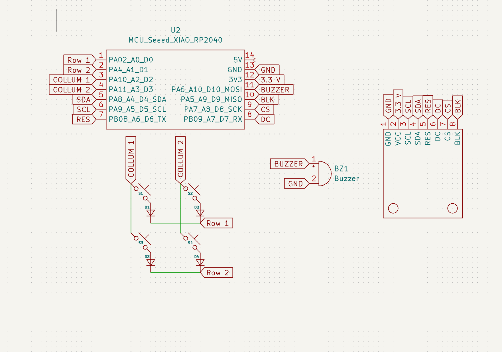
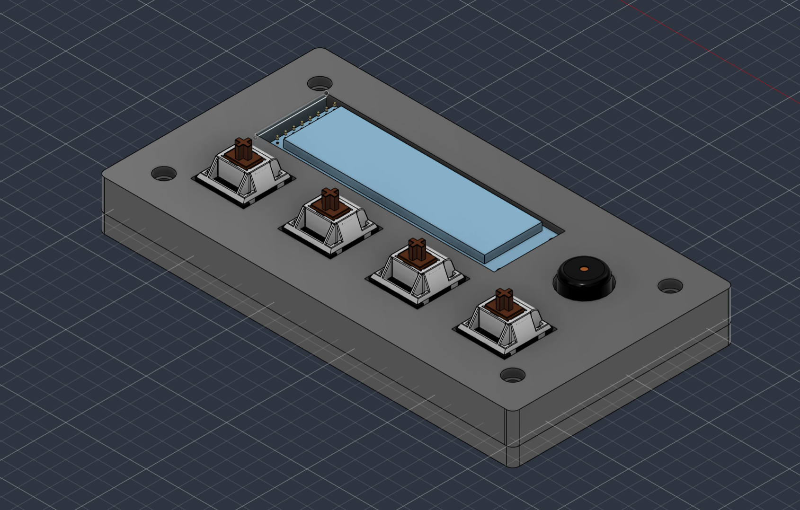

# Blare Bedside Alarm Clock

A custom-designed, compact desktop alarm clock powered by the Seeed Studio XIAO ESP32C3 microcontroller.

---

## Screenshots and Renders

### 1. Exploded View

### 2. Schematic

### 3. PCB Layout

### 4. Case Top and Bottom

### 5. Assembled View

---

## Bill of Materials (BOM)

| Item | Qty | Description |
| :--- | :---: | :--- |
| **Microcontroller** | 1 | Seeed Studio XIAO ESP32C3 |
| **Switches** | 4 | MX-Style Keyboard Switches |
| **Keycaps** | 4 | White Blank DSA Keycaps |
| **Diodes** | 4 | Through-Hole 1N4148 Diodes |
| **Display** | 1 | 2.25in TFT Screen |
| **Buzzer** | 1 | 3.3V Piezo Buzzer |
| **Heatset Inserts** | 4 | M3x5x4 Heatset Inserts |
| **Screws** | 4 | M3x8mm Screws |

---

## License

Distributed under the MIT License.
